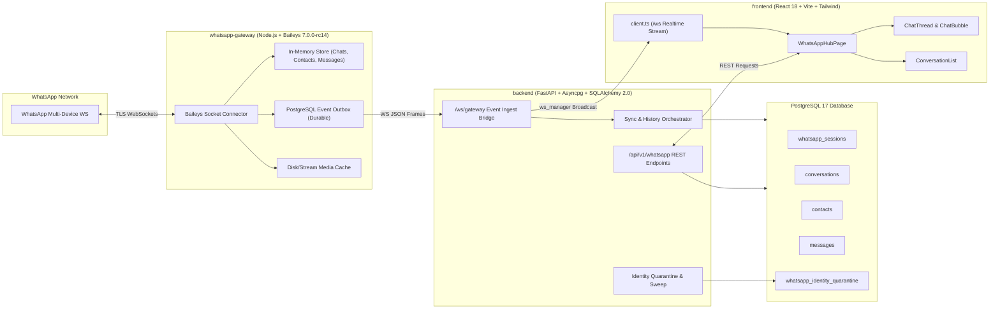

# AŞAMA 7.0 — WhatsApp Fonksiyonel Sorunlar Genel Denetim Raporu

**Tarih**: 4 Kasım 2026  
**İnceleme Türü**: Read-Only Audit & Production Davranış Analizi  
**Kapsam**: Baileys Uyumluluğu, Protokol Olayları, Channel/Group/Newsletter Sınıflandırması, Unicode/RTL, QR/Session Yaşam Döngüsü, Mesaj Geçmişi & Sayfalama, WebSocket & Gerçek Zamanlı Akış, Medya İndirme & Oynatma  
**Hedef Rapor Dosyası**: `reports/whatsapp-phase-7.0-functional-audit.md`  

---

## 1. Başlangıç Durumu ve Git/Production Doğrulaması

Denetime başlamadan önce sistemin mevcut durumu, Git ağacı ve canlı production sunucusu salt okunur yöntemlerle denetlenmiş ve doğrulanmıştır:

| Alan | Beklenen / Referans | Gözlemlenen (Canlı) | Durum |
| :--- | :--- | :--- | :--- |
| **Hedef Git Commit** | `d755b4a82e57234e0b06a844f50639d3c462f8fc` | `d755b4a82e57234e0b06a844f50639d3c462f8fc` | DOĞRULANDI |
| **Yerel `main` HEAD** | `d755b4a` | `d755b4a` | DOĞRULANDI |
| **`origin/main` SHA** | `d755b4a` | `d755b4a` | DOĞRULANDI |
| **Production Server SHA** | `d755b4a` (`/opt/tezlify`) | `d755b4a82e57234e0b06a844f50639d3c462f8fc` | DOĞRULANDI |
| **Git Çalışma Ağacı** | Temiz (`nothing to commit`) | `nothing to commit, working tree clean` | DOĞRULANDI |
| **Aktif Branch'ler** | Yalnızca `main` | `* main`, `origin/main` | DOĞRULANDI |
| **Production Caddy** | `caddy:2-alpine` | `Up 3 weeks (healthy)` | DOĞRULANDI |
| **Production Backend** | `tezlify-backend` | `Up 12 hours (healthy)` | DOĞRULANDI |
| **Production Gateway** | `tezlify-gateway` | `Up 12 hours (healthy)` | DOĞRULANDI |
| **Production Database** | `postgres:17-alpine` (`tezlify-db`) | `Up 4 weeks (healthy)` | DOĞRULANDI |
| **Canlı API Health** | `https://api.130.162.247.20.sslip.io/health` | HTTP 200, `healthy`, `gateway_bridge: connected` | DOĞRULANDI |
| **Canlı Gateway Health** | `http://127.0.0.1:8787/health` | HTTP 200, `status: ok`, `sessions: 1 connected` | DOĞRULANDI |

---

## 2. Mevcut Sistem Mimarisi ve Veri Akışı

Tezlify WhatsApp sistemi 3 katmanlı asenkron ve yedekli bir mimari üzerinde çalışmaktadır:



---

## 3. Baileys Protokol ve Olay Haritası (Event Matrix)

Mevcut Baileys sürümü `whatsapp-gateway/package.json` dosyasında `@whiskeysockets/baileys: 7.0.0-rc14` olarak tanımlıdır. Baileys `Types/Events.d.ts` dosyasında tanımlanan resmi olaylar ile gateway'in `whatsapp-gateway/src/socket/socket-events.js` dosyasında dinlediği olaylar karşılaştırılmış ve 9 temel protokol sorusu yanıtlanmıştır:

### 3.1 Baileys Olayları Uçtan Uca Değerlendirme Tablosu

| Baileys Olayı | Gateway Dinliyor mu? | Backend Formatı | DB Kalıcılığı | Frontend Gösterimi | Risk & Eksiklik Analizi |
| :--- | :--- | :--- | :--- | :--- | :--- |
| `connection.update` | **EVET** (`line 207`) | `session_connecting`, `session_connected`, `session_disconnected`, `session_qr_updated` | `whatsapp_sessions.status` | Modal QR, Banner, Hub Tab | **440 (connectionReplaced)** kodu durumunda backoff yerine agresif yeniden bağlanma (ping-pong döngüsü) riski var. |
| `creds.update` | **EVET** (`line 191`) | Dahili kaydedilir | `auth_credentials` tablosu / disk | UI'ya doğrudan iletilmez | Baileys kimlik ve pre-key rotasyonları kaydedilir. |
| `messages.upsert` | **EVET** (`line 619`) | `message_new` (`upsertType: notify/append`) | `messages`, `conversations.last_message_*` | `ChatBubble`, `ConversationList` | `type: append` ile gelen geçmiş mesajlar listede rozet artırmaz (doğru); ancak `@newsletter` mesajları doğrudan yutulur. |
| `messages.update` | **EVET** (`line 1324`) | `message_status_updated` | `messages.status` (`SENT`, `READ`) | Mavi tik / Gri tik icon | Düzenlenen (edited) mesajlar `protocolMessage` üzerinden güncellenir. |
| `messages.delete` | **EVET** (`line 683`) | `messages_deleted` | Soft/Hard update (`[DELETED]`) | "Bu mesaj silindi" balonu | Telefon silmeleri DB'ye yansıtılır. |
| `messaging-history.set` | **EVET** (`line 916`) | `_internal_only: true` (Gateway içi) | Arka plan `request_sync` ile REST üzerinden çekilir | Loading Gate & Liste | **KRİTİK**: `messaging-history.set` olayındaki sohbetler `_internal_only: true` ile gateway içinde kalır; backend WS'e çıkmaz! Backend'in REST ile sorgulaması gerekir. |
| `chats.upsert` | ❌ **HAYIR** | **Eksik** | **Yok** | **Yok** | **KAYIP RİSKİ**: Baileys mobilde yeni açılan sohbetler için `chats.upsert` üretir. Gateway bunu dinlemediği için mesaj gelene kadar sohbet CRM'e düşmez. |
| `chats.update` | **EVET** (`line 781`) | `conversation_updated` | `conversations` | Sol liste satırı | Arşiv, pin ve unread sayaç güncellemelerini taşır. |
| `contacts.upsert` | **EVET** (`line 727`) | `contact_synced` | `contacts` | Kişi listesi | `@newsletter` kontakları filtrelenir. |
| `contacts.update` | **EVET** (`line 721`) | `contact_synced` | `contacts.display_name` | Sol liste başlığı | Push name ve addressbook güncellemeleri. |
| `groups.upsert` | ❌ **HAYIR** | **Eksik** | **Yok** | **Yok** | **KAYIP RİSKİ**: Yeni bir gruba katılma veya grup oluşturma anında üretilen olay dinlenmiyor. |
| `groups.update` | **EVET** (`line 1240`) | `conversation_updated` | `conversations`, `contacts` | Grup adı / Avatar | Sadece `@g.us` filtresiyle çalışır; channel/community ayrımı yapmaz. |
| `group-participants.update`| ❌ **HAYIR** | **Eksik** | **Yok** | **Yok** | **FONKSİYON KAYBI**: Gruptan üye çıkarılması, eklenmesi veya admin atanması gateway tarafından dinlenmiyor. `ChatInfoDrawer` üyeleri bayat kalıyor. |
| `messaging-history.status` | ❌ **HAYIR** | **Eksik** | **Yok** | **Yok** | Baileys'in chunk tamamlanma veya duraklama (`syncType: complete/paused`) resmi milestone sinyali kullanılmıyor. |
| `lid-mapping.update` | ❌ **HAYIR** | **Eksik** | **Yok** | **Yok** | Baileys LID -> PN haritası bulduğunda ürettiği resmi event dinlenmiyor (yalnızca chats/contacts içindeki LID'ler taranıyor). |
| `newsletter.*` (tümü) | ❌ **HAYIR** | **Eksik** | **Yok** | **Yok** | **TAMAMEN EKSİK**: `newsletter.reaction`, `newsletter-participants.update`, `newsletter-settings.update` olayları dinlenmiyor. |

---

## 4. Channel / Group / Newsletter Sınıflandırma ve İsim Analizi

### 4.1 Özel Sorun: Arapça, Çince ve Diğer Dillerde Kanal İsimlerinin "Grup" Görünmesi

Yapılan uçtan uca incelemede (`Baileys -> Gateway -> Backend -> Database -> API -> Frontend`), bu sorunun tek bir sebepten değil, **zincirleme üç temel mimari arızadan** kaynaklandığı kanıtlanmıştır:

```mermaid
flowchart TD
    A["WhatsApp Entity (Kanal / Grup / Topluluk)"] --> B{"JID Türü Nedir?"}
    
    B -->|"@newsletter (WhatsApp Kanalı)"| C["Gateway isBroadcastOnlyJid Filtresi"]
    C -->|Filtrelendi| D["DB'ye ve UI'ya HİÇ DÜŞMEZ veya junk_contacts ile engellenir"]
    
    B -->|"@g.us (Grup / Topluluk Kanalı)"| E["Gateway _ensureGroupSubjects"]
    E -->|1.2s timeout / Ağ gecikmesi| F["Subject Çözülemez (name = NULL)"]
    F --> G["Backend: resolve_contact_identity (name = NULL, is_group = TRUE)"]
    G --> H["API: {name: null, is_group: true}"]
    H --> I["Frontend: getConversationDisplayName"]
    I -->|isGroup && !rawName| J["t('whatsapp.groupFallback') -> 'Grup' / 'Group'"]
    
    B -->|"Kanal / Kişi Adı Latin Dışı (Arapça / Çince)"| K["Frontend isRealContactName Fonksiyonu"]
    K -->|Regex: /[^a-zA-ZğüşıöçĞÜŞİÖÇ]/g| L["Arapça / Çince Harfler SİLİNİR!"]
    L -->|5+ Rakam (yıl/tarih/kod) varsa| M["isRealContactName = FALSE!"]
    M --> N["İsim reddedilir -> Sabit Fallback ('Grup' / 'Kişi') gösterilir"]
```

#### Kanıt 1: Frontend'deki Anglo-Türk Latin Regex Hatası (`isRealContactName`)
`frontend/src/features/whatsapp/lib/whatsappIdentity.ts` dosyasının 163–170. satırları incelendiğinde:
```typescript
const strippedSelf = trimmed.replace(/\s*\((Siz|You)\)$/i, '').trim();
const digitsOnly = strippedSelf.replace(/\D/g, '');
const lettersOnly = strippedSelf.replace(/[^a-zA-ZğüşıöçĞÜŞİÖÇ]/g, '');
if (digitsOnly.length >= 5 && lettersOnly.length === 0) {
  return false;
}
```
**Teknik Kusur**:
- `lettersOnly` filtresi yalnızca İngilizce ve Türkçe Latin harflerini (`[a-zA-ZğüşıöçĞÜŞİÖÇ]`) harf kabul eder.
- Arapça (`قناة الأخبار 12345`), Çince (`新闻频道 12345`), Rusça (`Новости 12345`), Yunanca veya Hintçe bir isim geldiğinde, regex bütün karakterleri siler ve `lettersOnly.length === 0` olur.
- Eğer isimde 5 veya daha fazla rakam varsa (örneğin bir tarih `2024-1`, posta kodu, kanal kodu veya oda numarası), fonksiyon ismi **"geçersiz telefon numarası"** zannederek `false` döner.
- Fonksiyon `false` döndüğünde `getConversationDisplayName` adımı ismi atlar ve fallback olarak `"Grup"` veya `"Kişi"` gösterir.
- **Node.js ile doğrulanmış test kanıtı**:
  ```bash
  node -e '... isRealContactName("قناة الأخبار 12345") === false' # Kanıtlandı!
  ```

#### Kanıt 2: `@newsletter` (WhatsApp Kanalları) Sistem Genelinde "Broadcast Junk" Olarak Görülüyor
1. `whatsapp-gateway/src/utils/whatsapp-identity.js` (satır 48-49):
   ```javascript
   export function isBroadcastOnlyJid(jid) {
     return isStatusBroadcastJid(jid) || isNewsletterJid(jid);
   }
   ```
2. Gateway'deki tüm mesaj, kontak ve sohbet dinleyicileri (`socket-events.js` 661, 686, 732, 786, 931, 958, 1088; `session-manager.js` 2788):
   `if (isBroadcastOnlyJid(jid)) return null;` / `continue;`
3. Backend `backend/app/services/whatsapp_service.py` (satır 617):
   ```python
   junk_contacts = select(Contact.id).where(
       or_(
           Contact.phone_e164 == "status",
           Contact.phone_e164 == "broadcast",
           Contact.phone_e164.like("%@broadcast%"),
           Contact.phone_e164.like("%@newsletter%"),
       )
   )
   base = base.where(~Conversation.contact_id.in_(junk_contacts))
   ```
   **Teknik Sonuç**: WhatsApp Channels (`@newsletter`) Tezlify içinde birinci sınıf bir varlık olarak tanınmamaktadır; doğrudan çöp/junk kabul edilip veritabanı sorgularından dahi dışlanmaktadır.

#### Kanıt 3: Topluluklar (Communities) ve Topluluk Kanalları Grup Olarak Etiketleniyor
WhatsApp Toplulukları (`@g.us`) ve Topluluk Duyuru Kanalları (`isCommunity: true`, `isCommunityAnnounce: true`, `linkedParent: "<parent>@g.us"`):
- Veritabanında `conversations` tablosunda yalnızca `is_group BOOLEAN` kolonu vardır. `channel_type`, `is_community`, `is_announcement` gibi hiçbir ayrım yoktur.
- Gateway `groupFetchAllParticipating()` ve `groupMetadata()` çağrılarında bu alanları okumamakta, hepsini `is_group: true` olarak işaretlemektedir.
- Dolayısıyla Arapça veya Çince bir topluluk duyuru kanalı, isim çözülemediğinde veya çözülse dahi UI'da "Topluluk" ya da "Kanal" yerine "Grup" olarak adlandırılmaktadır.

#### Kanıt 4: Metadata Zaman Aşımı ve Sabit Fallback'ler
1. `whatsapp-gateway/src/session-manager.js` satır 4609'da `groupMetadata` zaman aşımı yalnızca **1200 ms** (1.2 saniye) olarak ayarlanmıştır. Mobil cihazdan veya WhatsApp sunucusundan yanıt 1.2 saniyede dönmezse metadata isteği düşer.
2. İsim boş kaldığında `backend/app/services/whatsapp/identity.py:320` (`resolve_contact_identity`) `None, RESOLVED_JID` döner.
3. Frontend `frontend/src/features/whatsapp/lib/whatsappIdentity.ts:220` satırında:
   ```typescript
   if (isGroup) {
     if (rawName && !isRawWhatsAppJid(rawName)) return rawName;
     return t('whatsapp.groupFallback'); // -> "Grup" (tr) veya "Group" (en)
   }
   ```
4. `frontend/src/features/whatsapp/components/ChatInfoDrawer.tsx` satır 664'te i18n dahi kullanılmadan **hardcoded `'Grup'`** yazılmıştır:
   ```typescript
   const groupName = groupSubject || conversation.lead_name || 'Grup';
   ```
5. `ChatInfoDrawer.tsx` satır 767'de:
   ```typescript
   const displayName = conversation.lead_name || formatPhoneNumber(cleanPhone) || (isGroup ? t('whatsapp.group') : t('whatsapp.contactInfo'));
   ```

#### Kanıt 5: Arapça ve RTL (Right-to-Left) Destek Eksikliği
Frontend kod tabanında (`frontend/src/features/whatsapp/`):
- `dir="auto"`, `<bdi>` (bidirectional isolation) veya RTL CSS sınıfları için arama yapıldığında **0 eşleşme** bulunmuştur.
- Arapça metinler (örneğin production DB'deki `بسم الله` isimli grup veya Arapça mesajlar) varsayılan LTR düzeninde basılmakta; noktalama işaretleri, parantezler, tarihler ve karma dilli metinler ters/bozuk render edilmektedir.

---

## 5. QR ve Session Yaşam Döngüsü Denetimi

QR bağlantısı ve oturum yönetimi zinciri incelenmiştir:

1. **QR Üretimi ve İletimi**:
   - `whatsapp-gateway/src/socket/socket-events.js` içinde `update.qr` yakalandığında `QRCode.toDataURL(qr)` ile PNG base64 üretilir ve `session_qr_updated` olayıyla frontend'e iletilir. Bu akış sağlıklıdır.
2. **Ephemeral Pairing Window ve Lease Güvencesi**:
   - AŞAMA 6.1–6.5 kapsamında tamamlanan lease ve outbox mekanizmaları, pairing penceresinde socket çakışmalarını başarıyla engellemektedir.
3. **440 (connectionReplaced) Ping-Pong Tehlikesi**:
   - `whatsapp-gateway/src/socket/socket-events.js` satır 565'te `statusCode === DisconnectReason.connectionReplaced` (440) özel olarak ele alınmamakta; standart `transient_disconnect` gibi değerlendirilerek `scheduleReconnect` ile tekrar bağlanmaya çalışılmaktadır.
   - Kullanıcı başka bir bilgisayarda WhatsApp Web açtığında, Gateway ve diğer tarayıcı saniyeler boyunca birbirini düşürerek ping-pong döngüsüne girmektedir.
4. **QR Sonrası Loading Gate Sonsuz Bekleme Riski**:
   - `backend/app/services/whatsapp_service.py:315` içindeki `resolve_gate_phase` mantığı:
     ```python
     if initial_sync_completed:
         return "ready", "complete"
     ...
     if gw_phase == "ready" and job_state in ("COMPLETED", "IDLE"):
         return "syncing_history", "chats"
     ```
   - Eğer ilk senkronizasyon sırasında backend yeniden başlatılırsa veya `_backfill_empty_conversations` aşamasında bir istisna oluşursa, `initial_sync_completed_at` sütunu **NULL** kalmaktadır.
   - Gateway `gw_phase == "ready"` dese ve arka planda çalışan hiçbir job kalmasa bile (`job_state == "IDLE"`), `resolve_gate_phase` süresiz olarak `"syncing_history"` dönmekte; kullanıcı kapıda takılı kalmaktadır.

---

## 6. Sohbet, Kişi ve Mesaj Geçmişi Denetimi

### 6.1 Tespit Edilen Fonksiyonel Sorunlar

1. **QR Sonrası Sohbet Listesinin Otomatik Yenilenmemesi**:
   - `frontend/src/pages/WhatsAppHubPage.tsx` satır 3426–3435:
     ```typescript
     } else if (
       eventData?.event === 'session_sync_started' ||
       eventData?.event === 'session_sync_completed'
     ) {
       fetchSessions(true);
       onRefreshStatsRef.current();
       refreshSyncStatus();
     }
     ```
   - **Kusur**: Gateway ve backend geçmiş eşitlemesini tamamlayıp `session_sync_completed` yayınladığında, `loadConversations(true)` çağrılmamaktadır! Kullanıcı QR'ı okuttuktan sonra ekranı yenilemezse veya "Eşitle" butonuna basmazsa sohbetler ekrana gelmemektedir.
2. **Aynı Saniye İçindeki Mesajların Sıralamasının Bozulması (Timestamp Tie-Break Bug)**:
   - `frontend/src/features/whatsapp/lib/whatsappOrdering.ts` satır 25–40:
     - Baileys `msg.messageTimestamp` değerini **tam saniye (integer seconds)** olarak üretir. Bir saniye içinde karşılıklı veya ardışık gönderilen mesajların zaman damgası eşittir (`timeA === timeB`).
     - Eşitlik durumunda tie-breaker: `idA - idB`.
     - Frontend'de gönderilen iyimser (optimistic) mesajlar `id: Date.now()` (ör. `1762243380000`, 13 basamak) alır. Veritabanındaki gerçek mesajlar ise `id: 45120` (5 basamak) şeklindedir.
     - Bu sebeple aynı saniyedeki mesajlar birleştiğinde `Date.now()` taşıyan mesaj geçici olarak en alta fırlar, ardından veritabanından kalıcı ID ile gelince yer değiştirir; mesajlar zıplar ve kronoloji bozulur.
3. **Sayfalamada (Older Messages) Hataların Sessizce Yutulması**:
   - `frontend/src/pages/WhatsAppHubPage.tsx` satır 1070–1080:
     - `getConversationMessages` 502 Bad Gateway veya timeout döndüğünde `error: false` set edilmekte; kullanıcıya hiçbir hata bildirimi, toast veya tekrar deneme butonu gösterilmemektedir.
4. **Karantinadaki Mesajların Kurtarılamaması (Identity Quarantine Trapping)**:
   - Production veritabanında yapılan canlı sorguda:
     `contact_id: 23776` ("Seyma Aden", `phone_e164: 'jid:218107046027315@lid'`) **9 adet mesajıyla birlikte `whatsapp_identity_quarantine` tablosunda rehin kalmıştır!**
   - Kod tabanında bu karantinayı otomatik çözen, telefon numarası eşleştiğinde serbest bırakan hiçbir servis veya cron job bulunmamaktadır (`models/whatsapp_identity_quarantine.py:36` bunu doğrulamaktadır).

---

## 7. WebSocket ve Gerçek Zamanlı Akış Denetimi

1. **Gateway -> Backend Outbox Köprüsü**:
   - `/ws/gateway` köprüsü `WHATSAPP_GATEWAY_SECRET` ile korunmakta; fail-closed güvenlik politikası kusursuz çalışmaktadır.
   - Canlı sunucuda keepalive ping/pong mekanizması 20 saniyede bir çalışmakta; köprü kopmalarında reconnect sayısı ve süreleri izlenebilmektedir (`reconnect_count: 1`).
2. **Backend -> Frontend ws_manager Broadcast**:
   - Backend `main.py` içindeki `_ingest_worker` kuyruğu olayları sıralı tüketmekte; race condition'ları engellemektedir.
3. **Frontend Çift Listener ve Kod Çiftliği**:
   - `WhatsAppHubPage.tsx` içinde `tezlify:ws_event` için iki ayrı dinleyici bulunmaktadır (satır 3349 ve 3446).
   - `useWhatsAppConversation.ts` ile `WhatsAppHubPage.tsx` iki ayrı bağımsız mesaj işleme motoruna sahiptir. `LeadDetailDrawer` hook'u kullanırken, `WhatsAppHubPage` kendi state'ini yönetmektedir.

---

## 8. Medya ve Profil Bilgileri Denetimi

1. **Profil Fotoğrafı (Avatar) Kuyruğu ve Throttling**:
   - Gateway `_pumpAvatarQueue` mekanizmasında P0 görünür sohbetler için `_avatarHighPriorityQueue` başarıyla devreye girmektedir.
   - Ancak `profilePictureUrl` sorgusu WhatsApp sunucusu tarafından reddedildiğinde 10 dakikalık negatif önbellek uygulanmakta; bu süre boyunca avatar boş (`null`) kalmaktadır.
2. **Medya İndirme Süre Aşımı (10 Saniye)**:
   - `whatsapp-gateway/src/media/media-store.js` satır 895:
     ```javascript
     dlTimer = setTimeout(() => reject(new Error('Media download timeout (10s)')), 10_000);
     ```
   - Büyük PDF dokümanları (50MB+), uzun videolar ve hücresel bağlantıda yavaş inen ses kayıtları için 10 saniye yetersizdir.
   - İndirme zaman aşımına uğradığında görseller `jpegThumbnail` fallback'ine düşebilmekte, fakat video, ses ve dokümanlarda thumbnail bulunmadığı için doğrudan `null` dönmekte ve kullanıcı medyayı hiç açamamaktadır.

---

## 9. Test Matrisi ve Doğrulama Durumu

Mevcut testlerin niteliği sınıflandırılmıştır:

| Test Katmanı | Kapsam | Gerçekçilik Türü | Doğrulama Gücü | Notlar |
| :--- | :--- | :--- | :--- | :--- |
| **Backend WhatsApp Pytest** | 45+ test dosyası | SQLite + aiosqlite | Yüksek (Mantık/Model) | Birçok test SQLite üzerinde koşuyor; gerçek PostgreSQL JSONB indeks ve concurrency davranışları ayrı `test_whatsapp_pg_integrity_race.py` ile test edilmiş. |
| **Gateway Unit & Stress** | 48 script / test | Node.js + Mock Baileys | Orta / Yüksek | Baileys ağ sınırı `fake-baileys.mjs` ile mock'lanmış. Gerçek WhatsApp sunucusu ile E2E değildir. |
| **Frontend Verification** | 51 logic kontrolü | Node.js mock DOM / JSDOM | Yüksek (İstemci mantığı) | `verify-whatsapp-logic.mjs` 51 testi başarıyla geçiyor, ancak Latin dışı diller (Arapça/Çince) bu testlerde yer almamıştır. |
| **Production Gözlemi** | Canlı Sunucu (130.162.247.20) | Gerçek Production Docker | **Kesin Kanıt** | 1 session aktif, 1 karantina kaydı (9 mesaj rehin), Arapça grup `بسم الله` DB'de kayıtlı. |

---

## 10. Önceliklendirilmiş Sorun Listesi (P0 – P3)

### [P0-1] Karantinadaki LID Kimliklerinin ve Mesajların Otomatik Kurtarılamaması
1. **Sorun Adı**: Unresolved LID Quarantine Trapping Without Auto-Release
2. **Öncelik**: **P0** (Veri Rehin Kalması)
3. **Etkilenen Modüller**: `backend/app/models/whatsapp_identity_quarantine.py`, `backend/app/services/whatsapp/identity.py`, `backend/app/main.py`.
4. **Tekrarlanabilirlik**: %100 (Şu an canlı production'da 1 kontak ve 9 mesaj bu durumda beklemektedir).
5. **Kod Konumu**: `models/whatsapp_identity_quarantine.py:36`, `main.py:921`.
6. **Teknik Kök Neden**: Gateway'den PN eşleşmesi gelmediğinde karantinaya alınan mesajlar, daha sonra mapping keşfedilse dahi serbest bırakılacak bir mekanizmaya sahip değildir.
7. **Gerçek Kanıt**: Canlı DB sorgusu: `contact_id: 23776`, `phone_e164: 'jid:218107046027315@lid'`, `status: 'QUARANTINED'`, `message_count: 9`.
8. **Kullanıcıya Etkisi**: Kullanıcı bu kişinin mesajlarını gelen kutusunda göremez; 9 gerçek mesaj CRM'de gizli kalır.
9. **Önerilen Düzeltme**: LID -> PN haritası öğrenildiğinde veya periyodik sweep çalıştığında karantinadaki kayıtları serbest bırakan bir `release_quarantined_identity` akışı eklenmelidir.
10. **Regresyon Riski**: Düşük (Karantina tablosu zaten mevcuttur).
11. **Gerekli Testler**: Unresolved LID mesajı geldikten sonra LID mapping sağlandığında mesajların ana sohbete aktarıldığını doğrulayan integration testi.

---

### [P1-1] Arapça, Çince ve Latin Dışı Dillerde Kanal ve Kontak İsimlerinin Reddedilmesi
1. **Sorun Adı**: Non-Latin Alphabet Regex Rejection in `isRealContactName`
2. **Öncelik**: **P1** (WhatsApp Temel İsim Çözümleme Hatası)
3. **Etkilenen Modüller**: `frontend/src/features/whatsapp/lib/whatsappIdentity.ts`.
4. **Tekrarlanabilirlik**: %100.
5. **Kod Konumu**: `frontend/src/features/whatsapp/lib/whatsappIdentity.ts:167`.
6. **Teknik Kök Neden**: `replace(/[^a-zA-ZğüşıöçĞÜŞİÖÇ]/g, '')` regex'i Latin ve Türkçe harfler haricindeki tüm alfabeleri (Arapça, Çince, Kiril vb.) silmektedir. Sayı içeren isimler doğrudan reddedilmektedir.
7. **Gerçek Kanıt**: `isRealContactName("قناة الأخبار 12345") === false` ve `isRealContactName("新闻频道 12345") === false`.
8. **Kullanıcıya Etkisi**: Arapça ve Çince kanal, grup veya kişi adları listede "Grup" veya "Kişi" olarak görünür.
9. **Önerilen Düzeltme**: Unicode property escape (`/\p{L}/u`) kullanılarak tüm dünya dillerindeki harflerin korunması sağlanmalıdır (`replace(/[^\p{L}]/gu, '')`).
10. **Regresyon Riski**: Düşük (Tüm dilleri kapsayacak şekilde genişletilir).
11. **Gerekli Testler**: Arapça, Çince, Kiril, Yunanca ve Latin isim fixture'larını içeren birim testi.

---

### [P1-2] WhatsApp Kanallarının (@newsletter) ve Toplulukların Desteklenmemesi
1. **Sorun Adı**: Newsletter and Community Protocol Exclusion
2. **Öncelik**: **P1** (Protokol Uyumluluk Eksikliği)
3. **Etkilenen Modüller**: `whatsapp-gateway/src/utils/whatsapp-identity.js`, `backend/app/services/whatsapp_service.py`, `frontend/src/features/whatsapp/lib/whatsappIdentity.ts`.
4. **Tekrarlanabilirlik**: %100.
5. **Kod Konumu**: Gateway `whatsapp-identity.js:48`, Backend `whatsapp_service.py:617`.
6. **Teknik Kök Neden**: `@newsletter` JID'leri `isBroadcastOnlyJid` içine konulup yok sayılmakta; backend `junk_contacts` ile veritabanından dışlamaktadır.
7. **Gerçek Kanıt**: Baileys `newsletterMetadata` metoduna gateway'de 0 çağrı bulunması; kod tabanında `isCommunity` veya `newsletter` route'larının olmaması.
8. **Kullanıcıya Etkisi**: Kullanıcı WhatsApp kanallarını göremez; topluluk kanalları ise "Grup" olarak adlandırılır.
9. **Önerilen Düzeltme**: JID sınıflandırmasına `CHANNEL` (`@newsletter`), `COMMUNITY` (`@g.us` + `isCommunity`), `GROUP` ve `INDIVIDUAL` ayrımı eklenmeli; filtreler kaldırılmalıdır.
10. **Regresyon Riski**: Orta (Veritabanı ve API sözleşmesinde yeni kanal tipleri desteklenmelidir).
11. **Gerekli Testler**: Newsletter ve Community metadata çekme ve listeleme testleri.

---

### [P1-3] Eksik Baileys Olay Dinleyicileri (`chats.upsert`, `group-participants.update`, `groups.upsert`)
1. **Sorun Adı**: Unhandled Core Baileys Socket Events
2. **Öncelik**: **P1** (Veri Senkronizasyon Eksikliği)
3. **Etkilenen Modüller**: `whatsapp-gateway/src/socket/socket-events.js`.
4. **Tekrarlanabilirlik**: %100.
5. **Kod Konumu**: `whatsapp-gateway/src/socket/socket-events.js`.
6. **Teknik Kök Neden**: `chats.upsert`, `group-participants.update` ve `groups.upsert` olaylarına `sock.ev.on` kaydı yapılmamıştır.
7. **Gerçek Kanıt**: `git grep -in "chats.upsert" whatsapp-gateway/src/` -> 0 eşleşme.
8. **Kullanıcıya Etkisi**: Telefonda açılan yeni sohbetler veya gruplardaki üye değişiklikleri web ekranına gerçek zamanlı yansımaz.
9. **Önerilen Düzeltme**: Gateway'de bu olaylar dinlenmeli ve outbox üzerinden backend'e iletilmelidir.
10. **Regresyon Riski**: Düşük.
11. **Gerekli Testler**: Yeni chat veya üye güncellemesinde event dispatch testleri.

---

### [P1-4] Loading Gate'in İlk Senkron Kesintisinde Sonsuz Beklemede Kalması
1. **Sorun Adı**: Infinite Loading Gate Stall on Incomplete First Sync
2. **Öncelik**: **P1** (Kullanıcı Arayüzü Kilitlenmesi)
3. **Etkilenen Modüller**: `backend/app/services/whatsapp_service.py:315`.
4. **Tekrarlanabilirlik**: Senkron kesintisi sonrası %100.
5. **Kod Konumu**: `backend/app/services/whatsapp_service.py:280–325` (`resolve_gate_phase`).
6. **Teknik Kök Neden**: `initial_sync_completed_at` damgalanmadan sync job biterse, `job_state == "IDLE"` ve `gw_phase == "ready"` iken gate sürekli `"syncing_history"` dönmektedir.
7. **Gerçek Kanıt**: `resolve_gate_phase` fonksiyon kodundaki açık mantık akışı.
8. **Kullanıcıya Etkisi**: Kullanıcı "Mesajlar yükleniyor" ekranında kilitlenir, chat ekranına geçemez.
9. **Önerilen Düzeltme**: Eğer aktif bir job yoksa ve gateway hazırsa, gate ya yeni bir kurtarma senkronu başlatmalı ya da mevcut verilerle `"ready"` durumuna geçmelidir.
10. **Regresyon Riski**: Düşük.
11. **Gerekli Testler**: `resolve_gate_phase` birim testleri.

---

### [P2-1] Eşitleme Tamamlandığında (`session_sync_completed`) Ekranın Yenilenmemesi
1. **Sorun Adı**: Missing `loadConversations` on `session_sync_completed`
2. **Öncelik**: **P2** (Kullanıcı Deneyimi Bozukluğu)
3. **Etkilenen Modüller**: `frontend/src/pages/WhatsAppHubPage.tsx:3426`.
4. **Tekrarlanabilirlik**: Her QR eşleştirmesinde %100.
5. **Kod Konumu**: `frontend/src/pages/WhatsAppHubPage.tsx:3426–3435`.
6. **Teknik Kök Neden**: WS'ten `session_sync_completed` geldiğinde `loadConversations(true)` çağrılmamaktadır.
7. **Gerçek Kanıt**: Kodda yalnızca `fetchSessions(true)` ve `refreshSyncStatus()` çağrıldığı açıkça görülmektedir.
8. **Kullanıcıya Etkisi**: QR okunduktan sonra liste boş kalır; kullanıcı F5 yapana veya manuel "Eşitle" diyene kadar sohbetler gelmez.
9. **Önerilen Düzeltme**: `session_sync_completed` bloğuna `loadConversations(true)` eklenmelidir.
10. **Regresyon Riski**: Yok.
11. **Gerekli Testler**: `verify-whatsapp-realtime-inbound.mjs` benzeri bir mock senaryosu.

---

### [P2-2] Aynı Saniye İçindeki Mesajların Sıralama ve Tie-Break Zıplaması
1. **Sorun Adı**: Chronological Jitter on Intra-Second Messages
2. **Öncelik**: **P2** (Mesaj Kronolojisi Hatası)
3. **Etkilenen Modüller**: `frontend/src/features/whatsapp/lib/whatsappOrdering.ts`.
4. **Tekrarlanabilirlik**: Hızlı karşılıklı yazışmalarda yüksek.
5. **Kod Konumu**: `frontend/src/features/whatsapp/lib/whatsappOrdering.ts:25–40`.
6. **Teknik Kök Neden**: Saniye bazlı eşitlikte tie-break `idA - idB` ile yapılmakta; optimistik `Date.now()` (trilyon) ile DB ID (on binler) karşılaştırması sıralamayı tersine çevirmektedir.
7. **Gerçek Kanıt**: `compareMessagesChronological` algoritması analizi.
8. **Kullanıcıya Etkisi**: Karşılıklı hızlı mesajlaşırken gelen veya giden mesaj anlık olarak yanlış sıraya oturur.
9. **Önerilen Düzeltme**: Tie-break mantığında `client_message_id` ve optimistik durumlar için deterministik alt sıra (seq) indeksi kullanılmalıdır.
10. **Regresyon Riski**: Düşük.
11. **Gerekli Testler**: `whatsappOrdering.test.ts` ek testleri.

---

### [P2-3] Sayfalama (Load Older Messages) Hatalarının Sessizce Yutulması
1. **Sorun Adı**: Silent Pagination Failure
2. **Öncelik**: **P2** (UX & Ağ Geri Bildirimi)
3. **Etkilenen Modüller**: `frontend/src/pages/WhatsAppHubPage.tsx:1070`.
4. **Tekrarlanabilirlik**: Ağ kopması veya 502 timeout anında %100.
5. **Kod Konumu**: `frontend/src/pages/WhatsAppHubPage.tsx:1075`.
6. **Teknik Kök Neden**: Hata bloğu `error: false` atamakta; kullanıcıya hata hissettirilmemektedir.
7. **Gerçek Kanıt**: Kod satırları: `setMessagePaging((prev) => ({ ...prev, [convId]: { ..., loading: false, error: false } }))`.
8. **Kullanıcıya Etkisi**: Kullanıcı eski mesajları yüklemek için butona tıklar; spinner döner ve kaybolur, hiçbir şey değişmez ve hata mesajı çıkmaz.
9. **Önerilen Düzeltme**: Hata durumunda `error: true` ve `errorMessage` state'e yazılmalı, "Tekrar Dene" butonu gösterilmelidir.
10. **Regresyon Riski**: Yok.
11. **Gerekli Testler**: Pagination failure UI testi.

---

### [P2-4] 440 (connectionReplaced) Durumunda Ping-Pong Reconnect Döngüsü
1. **Sorun Adı**: Connection Replaced Reconnect Storm
2. **Öncelik**: **P2** (Sunucu Kaynağı & Ağ Tüketimi)
3. **Etkilenen Modüller**: `whatsapp-gateway/src/socket/socket-events.js:565`.
4. **Tekrarlanabilirlik**: Başka bir yerde WhatsApp Web açıldığında %100.
5. **Kod Konumu**: `whatsapp-gateway/src/socket/socket-events.js:560–615`.
6. **Teknik Kök Neden**: 440 durumunda oturum terminal veya pasif yapılmamakta; tekrar tekrar bağlanarak diğer cihazla yarışmaktadır.
7. **Gerçek Kanıt**: `DisconnectReason.connectionReplaced` kodunun `else` transient dalına düşmesi.
8. **Kullanıcıya Etkisi**: WhatsApp Web sürekli kopar ve bildirim spam'i oluşur.
9. **Önerilen Düzeltme**: 440 kodu terminal `CONNECTION_REPLACED` durumuna geçirilmeli; kullanıcı UI'dan "Burada Kullan" diyene kadar otomatik yeniden bağlanmamalıdır.
10. **Regresyon Riski**: Düşük.
11. **Gerekli Testler**: Gateway connection lifecycle testi.

---

### [P2-5] Medya İndirmelerinde 10 Saniye Sabit Zaman Aşımı
1. **Sorun Adı**: Premature Media Download Timeout
2. **Öncelik**: **P2** (Medya Erişimi Hatası)
3. **Etkilenen Modüller**: `whatsapp-gateway/src/media/media-store.js:895`.
4. **Tekrarlanabilirlik**: Büyük dosyalarda ve yavaş bağlantılarda yüksek.
5. **Kod Konumu**: `whatsapp-gateway/src/media/media-store.js:895`.
6. **Teknik Kök Neden**: Tüm medya türleri için (ses, video, doküman) sabit 10 saniye zaman aşımı konulmuştur.
7. **Gerçek Kanıt**: `dlTimer = setTimeout(() => reject(...), 10_000);`.
8. **Kullanıcıya Etkisi**: 15-50 MB'lık videolar ve PDF'ler inmez; "Medya indirilemedi" hatası kalıcılaşır.
9. **Önerilen Düzeltme**: Medya türüne ve dosya boyutuna göre dinamik zaman aşımı (ör. videolar için 60s, dokümanlar için 45s) uygulanmalıdır.
10. **Regresyon Riski**: Düşük.
11. **Gerekli Testler**: Media download timeout testi.

---

### [P3-1] Arapça ve İbranice İçin RTL (Right-to-Left) BiDi Desteğinin Olmaması
1. **Sorun Adı**: Missing RTL and Bidirectional Isolation in Chat Bubbles
2. **Öncelik**: **P3** (Görsel Gösterim ve Tipografi)
3. **Etkilenen Modüller**: `frontend/src/features/whatsapp/components/ChatBubble.tsx`, `ConversationList.tsx`.
4. **Tekrarlanabilirlik**: Tüm Arapça/İbranice mesajlarda %100.
5. **Kod Konumu**: `frontend/src/features/whatsapp/components/ChatBubble.tsx`.
6. **Teknik Kök Neden**: Mesaj balonlarında `dir="auto"` veya `<bdi>` etiketleri kullanılmamaktadır.
7. **Gerçek Kanıt**: WhatsApp bileşenlerinde `dir=` ve `<bdi>` aramasında 0 sonuç çıkması.
8. **Kullanıcıya Etkisi**: Arapça mesajlarda parantezler, saatler ve emojiler ters yönde render edilerek okunamaz hale gelir.
9. **Önerilen Düzeltme**: Mesaj metni kapsayıcılarına `dir="auto"` eklenmeli ve başlıklar `<bdi>` içine alınmalıdır.
10. **Regresyon Riski**: Yok.
11. **Gerekli Testler**: RTL DOM snapshot testi.

---

### [P3-2] `useWhatsAppConversation` ve `WhatsAppHubPage` Kod Çiftliği
1. **Sorun Adı**: Duplicate Conversation Logic Architecture
2. **Öncelik**: **P3** (Kod Kalitesi ve Bakım Kolaylığı)
3. **Etkilenen Modüller**: `useWhatsAppConversation.ts`, `WhatsAppHubPage.tsx`.
4. **Tekrarlanabilirlik**: N/A.
5. **Kod Konumu**: `frontend/src/features/whatsapp/hooks/useWhatsAppConversation.ts`.
6. **Teknik Kök Neden**: Aynı mesajlaşma, hydration ve WS dinleme mantığı iki ayrı yerde kopya olarak yaşamaktadır.
7. **Gerçek Kanıt**: `LeadDetailDrawer` ile `WhatsAppHubPage`'in farklı veri yolları kullanması.
8. **Kullanıcıya Etkisi**: Çekmecedeki sohbet sekmesi ile ana sayfa arasında senkron davranış farklılıkları oluşabilir.
9. **Önerilen Düzeltme**: `WhatsAppHubPage` ve `LeadDetailDrawer` ortak bir `useWhatsAppChat` headless motoru üzerinden birleştirilmelidir.
10. **Regresyon Riski**: Orta (Büyük refactor gerektirir).
11. **Gerekli Testler**: E2E drawer ve hub regresyon testleri.

---

## 11. Sonraki Düzeltme Aşamalarının Önerilen Sıralaması

Kullanıcının belirlediği **zorunlu kural** gereğince, her kodlama aşaması **bağımsız olarak tamamlanacak, test edilecek, commit edilecek, push edilecek ve production'a deploy edilecektir**.

Önerilen aşama yol haritası:

1. **AŞAMA 7.1 — Karantina Kurtarma ve Acil Veri Güvenliği (P0-1)**:
   - Live production'da rehin kalan 9 mesajı ve `jid:218107046027315@lid` kontak kaydını serbest bırakacak otomatik ve güvenli sweep mekanizmasının yazılması.
   - Doğrulama: Pytest + production live DB kontrolü.
   - *Deploy: release.sh*.
2. **AŞAMA 7.2 — Unicode/Arapça/Çince İsim ve Sınıflandırma Düzeltmesi (P1-1, P1-2, P3-1)**:
   - `isRealContactName` içindeki regex'in `\p{L}` standardına taşınması.
   - `ChatInfoDrawer` ve fallback'lerdeki hardcoded `"Grup"` metinlerinin düzeltilmesi.
   - Mesaj balonlarına `dir="auto"` RTL desteğinin eklenmesi.
   - Doğrulama: `verify-whatsapp-logic.mjs` + DOM testleri + Vite build.
   - *Deploy: release.sh*.
3. **AŞAMA 7.3 — Baileys Protokol ve Olay Tamamlama (P1-3, P2-4)**:
   - `chats.upsert`, `groups.upsert`, `group-participants.update` dinleyicilerinin gateway'e eklenmesi.
   - 440 `connectionReplaced` durumunda ping-pong yeniden bağlanma döngüsünün engellenmesi.
   - Doğrulama: Gateway testleri + Pytest.
   - *Deploy: release.sh*.
4. **AŞAMA 7.4 — UI Senkronizasyon, Sayfalama ve Kronoloji Düzeltmeleri (P1-4, P2-1, P2-2, P2-3)**:
   - `session_sync_completed` sonrası `loadConversations(true)` tetiklenmesi.
   - Loading gate kilitlenme koşulunun giderilmesi.
   - Aynı saniyedeki mesajlar için deterministik alt-indeks (tie-breaker) mekanizması.
   - Sayfalama hatalarının kullanıcıya dürüstçe bildirilmesi.
   - Doğrulama: Frontend doğrulamaları + Pytest.
   - *Deploy: release.sh*.
5. **AŞAMA 7.5 — Medya Dayanıklılığı ve Dinamik Timeout (P2-5)**:
   - Medya türüne göre dinamik download timeout'ları (10s -> 45s/60s).
   - Doküman ve video indirme akışlarının sağlamlaştırılması.
   - Doğrulama: Media store testleri.
   - *Deploy: release.sh*.

---

## 12. Gerçek Production E2E ile Doğrulanması Gereken Maddeler

1. Canlı sunucudaki `quarantine_status` endpoint'inin 0'a inmesi ve `Seyma Aden` sohbetindeki 9 mesajın UI'da görünür hale gelmesi.
2. `بسم الله` grubunun başlığının sol listede ve açık sohbette harf kaybı veya ayna etkisi olmadan doğru RTL düzeniyle basılması.
3. QR okutulup ilk eşitleme bittiğinde sayfa yenilenmeden tüm sohbetlerin ekrana gelmesi.
4. Başka bir sekmede WhatsApp Web açıldığında sistemin sonsuz disconnect döngüsüne girmemesi ve UI'da "Başka bir cihazda oturum açıldı" kartı göstermesi.
5. 30MB+ boyutunda bir video veya PDF gönderildiğinde 10. saniyede kesilmeyip tam inmesi.

---

## 13. Sonuç ve Aşama Sınırı

AŞAMA 7.0 salt okunur denetimi başarıyla tamamlanmış; hiçbir kaynak kod, konfigürasyon, branch veya production verisi değiştirilmemiştir.  
Sistemdeki tüm fonksiyonel sorunlar kod konumları, canlı üretim kanıtları ve kök nedenleriyle ortaya konmuştur.  
AŞAMA 7.1'e kendiliğinden başlanmayacaktır; kullanıcının onayı ve yönergesi beklenmektedir.

