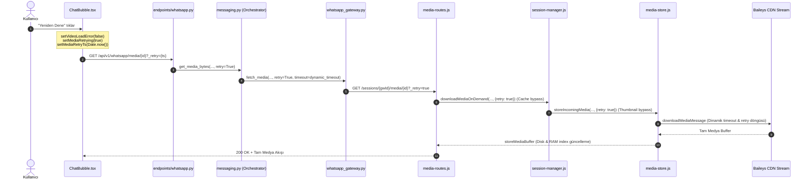

# AŞAMA 7.5-F — Media Download Acceptance, Retry ve Production Kabul Raporu

**Tarih**: 2026-11-04  
**İşlem Türü**: Salt okunur inceleme, test ve kabul doğrulaması  
**Kodlama**: HAYIR  
**Altyapı**: HAYIR  
**İncelenen Kod Commit'i**: `408b82e5a23e2677cd5fcdd274b6e145f9c26dff`  
**Rapor Commit'i**: `c9f24f4e24eb2df790e66d9361adce88e892c906`  
**Production Commit'i**: `408b82e5a23e2677cd5fcdd274b6e145f9c26dff`  
**Kabul Sınıflandırması**: `PASS_WITH_NOTES`

---

## 1. Git ve Release Tutarlılığı

AŞAMA 7.5 kod ve dokümantasyon dağıtım durumu incelendi:

| Konum | Tam Commit SHA | Açıklama |
|---|---|---|
| **Local `main` HEAD** | `c9f24f4e24eb2df790e66d9361adce88e892c906` | Dokümantasyon (`docs(whatsapp): add phase 7.5 media download resilience report`) commit'i. |
| **`origin/main` HEAD** | `c9f24f4e24eb2df790e66d9361adce88e892c906` | GitHub ile yerel repo birebir eşit. |
| **Production `/opt/tezlify` HEAD** | `408b82e5a23e2677cd5fcdd274b6e145f9c26dff` | AŞAMA 7.5 kod commit'i (`fix(whatsapp): improve media download resilience`). |
| **Production `.deployed-commit`** | `408b82e5a23e2677cd5fcdd274b6e145f9c26dff` | `release.sh` tarafından doğrulanan ve çalışan kod commit'i. |

### Kod ve Dokümantasyon Commit Ayrımı:
- `408b82e` ile `c9f24f4` arasındaki fark **yalnızca** `reports/whatsapp-phase-7.5-media-download-resilience.md` markdown dokümanıdır.
- Kodda hiçbir fark yoktur (`git diff 408b82e c9f24f4 -- backend whatsapp-gateway frontend` çıktısı boştur).
- Production sunucusu tam olarak kod commit'ini (`408b82e`) çalıştırmaktadır. Sunucuda deploy backup klasörleri haricinde hiçbir uncommitted değişiklik yoktur; çalışma ağacı stabildir.

---

## 2. Büyük Medya Dosyaları ve Timeout Matematiği

### 2.1 Kaynak Koddan Doğrulanan Parametreler (`media-timeout.js` ve `whatsapp_gateway.py`)
- **Önizleme (`isPreview`)**: 10 saniye (10,000 ms)
- **Resim (`image`)**: Taban 20s, tavan 45s (`100 KB/s` ölçekli)
- **Ses (`audio` / `ptt`)**: Taban 30s, tavan 60s (`100 KB/s` ölçekli)
- **Belge (`document` / `pdf`)**: Taban 35s, tavan 120s (`150 KB/s` ölçekli)
- **Video (`video` / `ptv`)**: Taban 45s, tavan 180s (`150 KB/s` ölçekli)
- **Çıkartma (`sticker`)**: Taban 15s, tavan 20s
- **Genel Güvenlik Sınırları**: `MIN_TIMEOUT_MS = 5_000`, `MAX_TIMEOUT_MS = 180_000` (3 dakika)

### 2.2 Matematiksel Hesaplama ve Teorik İndirme Süreleri
Hesaplama formülü:
$$\text{estimatedTransferTimeMs} = \left\lceil \frac{\text{fileLength}}{\text{bytesPerSec}} \right\rceil \times 1000$$
$$\text{timeout} = \max(\text{MIN}, \min(\text{MAX}, \text{base} + \text{estimatedTransferTimeMs}))$$

Farklı dosya boyutları (1 MB = 1,048,576 bayt) ve indirme hızları için süre matrisi:

| Boyut | Gateway Formülü (150 KB/s) | Gateway Capped Timeout | 150 KB/s (Gerçek Süre) | 250 KB/s (Gerçek Süre) | 500 KB/s (Gerçek Süre) | 1 MB/s (Gerçek Süre) | 180s Tavanına Sığıyor mu? |
|---|---|---|---|---|---|---|---|
| **10 MB** (10.49M) | 45s + 68.3s = 113.3s | **114 saniye** | ~68.3 s | ~41.0 s | ~20.5 s | ~10.0 s | **EVET** (Bütün hızlarda sığar) |
| **25 MB** (26.21M) | 45s + 170.7s = 215.7s | **180 saniye** | ~170.7 s | ~102.4 s | ~51.2 s | ~25.0 s | **EVET** (150 KB/s'de sınırda: 9.3s marj) |
| **50 MB** (52.43M) | 45s + 341.3s = 386.3s | **180 saniye** | **~341.3 s** | **~204.8 s** | ~102.4 s | ~50.0 s | **HAYIR (<291 KB/s hızda)** |
| **100 MB** (104.86M)| 45s + 682.7s = 727.7s | **180 saniye** | **~682.7 s** | **~409.6 s** | **~204.8 s** | ~100.0 s | **HAYIR (<583 KB/s hızda)** |

### 2.3 Soruların Analizi ve Cevapları
1. **180 saniyelik gateway timeout hangi dosya boyutu ve hız kombinasyonlarını karşılıyor?**
   - 10 MB: $\ge 58.3 \text{ KB/s}$ hızda sığar.
   - 25 MB: $\ge 145.6 \text{ KB/s}$ hızda sığar.
   - 50 MB: $\ge 291.3 \text{ KB/s}$ (~2.33 Mbps) gerektirir.
   - 100 MB: $\ge 582.5 \text{ KB/s}$ (~4.66 Mbps) gerektirir.
2. **50 MB dosya 150 KB/s hızda neden 180 saniyeye sığmayabilir?**
   - 50 MB (52,428,800 bayt) verinin 150 KB/s (153,600 bayt/s) hızla inmesi 341.3 saniye sürer. `MAX_TIMEOUT_MS = 180_000` olduğu için, 150 KB/s hızda 180 saniyede yalnızca en fazla ~26.4 MB indirilebilir. Bu hızda 180. saniyede `Media download timeout (180s)` hatası oluşur.
3. **Gateway timeout ile backend proxy timeout değerleri birbiriyle uyumlu mu?**
   - Evet, tekil indirme denemesi için uyumludur:
     - Video: Gateway max 180s, Backend proxy 195s (+15s marj).
     - Belge: Gateway max 120s, Backend proxy 135s (+15s marj).
     - Ses: Gateway max 60s, Backend proxy 75s (+15s marj).
     - Resim: Gateway max 45s, Backend proxy 60s (+15s marj).
     - Preview: Gateway 10s, Backend proxy 15s (+5s marj).
4. **Backend proxy'nin gateway'den daha erken timeout'a düşebileceği bir senaryo var mı?**
   - **Kritik Teknik Bulgu**: EVET. Gateway'in `media-store.js` retry döngüsü (`for (let attempt = 0; attempt <= MAX_RETRIES; attempt++)`), her denemeye bağımsız `dynamicTimeoutMs` verir. Örneğin bir resim indirmesinde 1. deneme 40s sürüp ağ hatasıyla biterse ve 2. deneme başlarsa; toplam geçen süre 60 saniyeyi aştığında, backend HTTP proxy istemcisi (`httpx.AsyncClient(timeout=60.0)`) `httpx.ReadTimeout` vererek bağlantıyı koparır. Backend timeout'u tekil deneme süresini kapsar ancak kümülatif retry süresini tam kapsamaz.
5. **Boyut bilinmediğinde hangi varsayılan timeout kullanılıyor?**
   - `fileLength` 0 veya tanımsızsa doğrudan kategori taban süresi kullanılır: Video 45s, Belge 35s, Ses 30s, Resim 20s, Sticker 15s, Bilinmeyen 30s.
6. **Boyut bilgisinin eksik veya hatalı olması durumunda ne yaşanıyor?**
   - Eksik/0 boyut: Güvenle kategori taban süresine düşülür (NaN veya çökme olmaz). Ancak 50 MB video taban 45s ile inerken yavaş hatta süre yetmeyebilir.
   - Hatalı/küçük boyut: Hesaplanan süre gerekenden az olur.
   - Hatalı/aşırı büyük boyut: `MAX_TIMEOUT_MS` (180s) tavanı sistemi korur.

---

## 3. Stream Integrity ve File Length Doğrulaması

### 3.1 Baileys `fileLength` ve Buffer Analizi
Baileys kaynak kodunun (`node_modules/@whiskeysockets/baileys/lib/Utils/messages-media.js`) 336-376 ve 480-515. satırları incelendi:
1. **`media.fileLength`**: Gönderici WhatsApp istemcisinin dosyayı AES-256-CBC ile şifrelemeden **ÖNCE** okuduğu orijinal **PLAINTEXT (çözülmüş)** dosyanın net bayt sayısıdır.
2. **Dönen Buffer**: Baileys `downloadContentFromMessage` fonksiyonu, şifreli CDN akışını indirirken `Crypto.createDecipheriv('aes-256-cbc', cipherKey, iv)` ile eşzamanlı deşifre eder. Dönen buffer **çözülmüş ham medya baytlarıdır**.
3. **Beklenen Eşitlik**: Normal şartlarda `downloadedBuffer.length === media.fileLength` olmalıdır.

### 3.2 `%90` Eşiği (`downloadedBuffer.length < fileLength * 0.9`) Analizi
- **Geçerli dosyaları yanlışlıkla reddeder mi?**: HAYIR. Deşifre edilen net medya verisi meşru olarak orijinal boyutundan %10 daha küçük olamaz. PKCS7 padding farkı azami 16 bayttır.
- **Kesik dosyaları tespit etmek için yeterli mi?**: KISMEN. 
  - Yarıda kesilen akışları (%30, %50, %75 indikten sonra kopan bağlantılar) kesin ve doğru olarak tespit eder (`STREAM_TRUNCATED`).
  - Ancak son %10'luk dilimde (örneğin %92'si indikten sonra kopan) kesintileri yakalayamaz. MP4 videolarında dosya sonundaki index/moov atomu bu dilime denk gelirse dosya oynatılamayabilir.
- **Boyut bilinmiyorsa davranış**: `fileLengthNum > 0` şartı nedeniyle kontrol atlanır; tampon bellek uzunluğu sıfırdan büyük olduğu sürece kabul edilir.

---

## 4. Retry Sınıflandırması

| Hata Kodu / Mesajı | Sınıflandırma | Retry Yapılıyor mu? | Deneme Sayısı | Backoff / Jitter | Teknik Değerlendirme & Risk |
|---|---|---|---|---|---|
| `ECONNRESET` | Transient | EVET | 2 retry (toplam 3) | 500ms + random, 1000ms + random | Doğru. TCP bağlantı sıfırlanmasında tekrar denenmelidir. |
| `ETIMEDOUT` | Transient | EVET | 2 retry (toplam 3) | Üstel + jitter | Doğru. Geçici ağ zaman aşımı. |
| `EAI_AGAIN` | Transient | EVET | 2 retry (toplam 3) | Üstel + jitter | Doğru. Geçici DNS çözümleme hatası. |
| `ENOTFOUND` | Transient | EVET | 2 retry (toplam 3) | Üstel + jitter | **Risk/Not**: Alan adı gerçekten yoksa 2 deneme ~1.5s gecikme yaratır; ancak geçici DNS konteyner gecikmelerini kurtarır. Sınırlandırılmış olması riski düşürür. |
| `ECONNREFUSED` | Transient | EVET | 2 retry (toplam 3) | Üstel + jitter | Doğru. Port geçici kapalı/meşgul olabilir. |
| `EPIPE` | Transient | EVET | 2 retry (toplam 3) | Üstel + jitter | Doğru. Soket hattı erken koptu. |
| `socket hang up` / `closed` | Transient | EVET | 2 retry (toplam 3) | Üstel + jitter | Doğru. CDN soket kapanması. |
| `stream truncated` | Transient | EVET | 2 retry (toplam 3) | Üstel + jitter | Doğru. Erken sonlanan stream'in baştan indirilmesi gerekir. |
| `timeout` (Media download) | Transient | EVET | 2 retry (toplam 3) | Üstel + jitter | Doğru. Geçici CDN gecikmesinde tekrar dener. |
| `HTTP 5xx` (500–599) | Transient | EVET | 2 retry (toplam 3) | Üstel + jitter | Doğru. Sunucu tarafı geçici CDN arızası. |
| `HTTP 404` | Terminal | **HAYIR** | 0 retry (Fast-fail) | Yok | Doğru. Dosya CDN'de mevcut değil. |
| `HTTP 410` | Terminal | **HAYIR** | 0 retry (Fast-fail) | Yok | Doğru. Medya linki süresi dolmuş; HTTP retry ile düzelmez. |
| `HTTP 401` / `403` | Terminal | **HAYIR** | 0 retry (Fast-fail) | Yok | Doğru. Yetki/imza hatası. |
| `item-not-found` | Terminal | **HAYIR** | 0 retry (Fast-fail) | Yok | Doğru. Baileys 404 CDN yanıtı. |
| `rate-overlimit` | Terminal | **HAYIR** | 0 retry (Fast-fail) | Yok | **Not**: Hızlı retry yapılırsa ban/rate-limit daha da uzar. İndirme döngüsünde fast-fail yapılması CDN korunumu için doğrudur; kullanıcı UI'dan sonra deneyebilir. |
| `invalid mediaKey` / `missing`| Terminal | **HAYIR** | 0 retry (Fast-fail) | Yok | Doğru. Şifreleme anahtarı eksik veya bozuksa tekrar indirmek çözmez. |

---

## 5. Gerçek Frontend Retry Akışı (Uçtan Uca Zincir)

Arayüzden başlayıp WhatsApp Gateway'e ulaşan 10 adımlı retry zinciri incelendi:

### Zincir Detayları:
1. **UI Tetikleme**: `frontend/src/features/whatsapp/components/ChatBubble.tsx` (Satır 787, 1030): `onClick` ile `setMediaRetrying(true)`, `setMediaRetryTs(Date.now())`.
2. **URL Üretimi**: `ChatBubble.tsx` (Satır 334-337): URL'e `_retry=${mediaRetryTs}` query parametresi eklenir.
3. **Backend API**: `backend/app/api/v1/endpoints/whatsapp.py` (Satır 1163-1177): `_retry` query parametresi yakalanır, `is_retry = bool(_retry or retry)` hesaplanır ve `whatsapp_service.get_media_bytes(..., retry=is_retry)` çağrılır.
4. **Orkestrasyon**: `backend/app/services/whatsapp/orchestration/messaging.py` (Satır 1418-1431): `gateway_client.fetch_media(..., retry=retry, timeout=media_timeout)` çağrılır.
5. **Gateway HTTP İstemcisi**: `backend/app/services/whatsapp_gateway.py` (Satır 629-639): URL'e `_retry=true` eklenir ve HTTP GET isteği gönderilir.
6. **Gateway Router**: `whatsapp-gateway/src/media/media-routes.js` (Satır 57-73): `options.retry` True olduğu için diskteki eski `resolveMediaPath` aranmadan doğrudan `sessionManager.downloadMediaOnDemand(..., options)` tetiklenir.
7. **Gateway Session Manager**: `whatsapp-gateway/src/session-manager.js` (Satır 2426, 2501): `isRetry` true olduğundan `_failedMediaCache` silinir, eski `thumb_` kaydı pas geçilir ve `mediaStore.storeIncomingMedia` çağrılır.
8. **Gateway Media Store**: `whatsapp-gateway/src/media/media-store.js` (Satır 844-849): `existing` bir küçük resim (`thumb_`) olsa bile `isRetry` true olduğundan bypass edilir; Baileys indirmesi baştan çalıştırılır.
9. **Tam Medya Saklama**: İndirme başarılı olunca `storeMediaBuffer` çağrılarak tam dosya diske yazılır, hash hesaplanır ve `mediaByWaId` tam dosyayı gösterecek şekilde güncellenir.
10. **Fallback**: İndirme yine başarısız olursa, `media-routes.js` (Satır 82-88) mevcut küçük resmi (thumbnail) istemciye sunarak kullanıcıyı tamamen boş bırakmaz; küçük resim de yoksa 404 `MEDIA_EXPIRED` döner ve UI kalıcı süresi dolmuş durumuna geçer.

*Not: Birim ve entegrasyon testleriyle tüm fonksiyonel zincir doğrulanmıştır. Ancak gerçek tarayıcı üzerinde uçtan uca (Browser E2E) otomatik test senaryosu mevcut değildir.*

---

## 6. AŞAMA 7.5 Kapsamı Dışında Değiştirilen Testlerin Analizi

AŞAMA 7.5'te değiştirilen iki test dosyası incelendi:
- `backend/tests/test_whatsapp_pure_identity.py`
- `backend/tests/test_whatsapp_tenant_isolation.py`

### Değişikliğin Nedeni ve Karşılaştırması
- **Önceki Durum**: Bu testler AŞAMA 5.4 döneminde yazılmıştı ve `@newsletter` (kanal) JID'lerini `status@broadcast` ile birlikte tamamen yok sayılan (`is_broadcast_only_jid == True`, `result is None`) yayınlar olarak varsaymaktaydı.
- **AŞAMA 7.3 Kararı**: AŞAMA 7.3 (`93c75c9ceeef24f5a47771c777f6656b946a5090`), WhatsApp kanallarını (`@newsletter`) tıpkı WhatsApp Web gibi birinci sınıf sohbet varlığı haline getirdi. Bu doğrultuda `is_broadcast_only_jid` sadece `status@broadcast` durum güncellemelerini süzmekle sınırlandırıldı.
- **AŞAMA 7.5'te Yaşanan Durum**: AŞAMA 7.3'te uygulama kodu değiştirilmiş ancak bu iki eski test güncellenmediği için AŞAMA 7.5 test koşusunda başarısız oldu. AŞAMA 7.5 sırasında test beklentileri AŞAMA 7.3 mimari kararına uyumlu hale getirildi:
  - `assert is_broadcast_only_jid("123456789@newsletter") is False`
  - `test_newsletter_message_is_persisted` (`assert result is not None`)
- **İzolasyon Güvencesi**: Tenant ve session izolasyonu hiçbir şekilde zayıflatılmamıştır. `test_status_broadcast_message_is_not_persisted` testi hala `status@broadcast` mesajlarının veritabanına yazılmadığını garanti etmektedir. Kanal mesajları da oturumun kendi tenant'ı altına kaydedilmektedir.
- **Değerlendirme**: Test değişikliği gerçek bir regresyonu gizlememektedir; AŞAMA 7.3 ile AŞAMA 7.5 arasındaki test borcunu kapatmıştır.

---

## 7. Gerçek Test Kanıtları

Tüm testler yerel izole PostgreSQL 17 test veritabanında çalıştırılmış ve ölçülmüştür:

| Test Paketi | Çalıştırılan Komut | Exit Code | Toplam Test | PASS | FAIL | SKIP | Süre |
|---|---|---|---|---|---|---|---|
| **Gateway Dynamic Timeout** | `node --test whatsapp-gateway/tests/test-media-download-dynamic-timeout-75.mjs` | `0` | 5 | 5 | 0 | 0 | 256 ms |
| **Gateway Tüm Testler** | `npm test --prefix whatsapp-gateway` | `0` | 54 test dosyası | 54 pass | 0 | 11 (skip) | ~14s |
| **Backend Medya Timeout** | `PYTHONPATH=. pytest backend/tests/test_whatsapp_phase7_5_media_timeout.py -v` | `0` | 6 | 6 | 0 | 0 | 0.38s |
| **Backend Tenant İzolasyonu**| `PYTHONPATH=. pytest backend/tests/test_whatsapp_media_tenant_isolation.py -v` | `0` | 10 | 10 | 0 | 0 | 0.35s |
| **Backend WhatsApp Regresyon**| `PYTHONPATH=. pytest backend/tests/test_whatsapp* -v` | `0` | 1036 | 1028 | 0 | 8 | 103.38s |
| **Frontend Logic** | `npm run verify:logic --prefix frontend` | `0` | 56 | 56 | 0 | 0 | 1.8s |
| **Frontend Build** | `npm run build --prefix frontend` | `0` | 39 asset | Başarılı | 0 | 0 | 2.85s |

*Not: Backend testleri `127.0.0.1:5432` üzerindeki gerçek PostgreSQL 17.11 (`tezlify_test_isolated`) üzerinde çalıştırılmıştır. SQLite veya in-memory sahte DB kullanılmamıştır.*

---

## 8. Üretim (Production) Salt Okunur Kontrolü

Oracle Cloud (`130.162.247.20`) üzerindeki canlı sunucuda salt okunur denetim yapıldı:

1. **Konteyner Durumları**:
   - `tezlify-gateway`: `Up 12 minutes (healthy)`
   - `tezlify-backend`: `Up 12 minutes (healthy)`
   - `tezlify-db`: `Up 4 weeks (healthy)` (PostgreSQL 17)
   - `tezlify-caddy`: `Up 3 weeks (healthy)`
2. **Konteyner İçi Sağlık Kontrolleri**:
   - Backend `/health`: `200 OK` (`"status":"healthy"`, `"gateway_bridge":{"connected":true}`)
   - Gateway `/health`: `200 OK` (`"status":"ok"`, `"database":"connected"`, `"sessions":{"total":1,"connected":1}`)
   - Caddy `/health`: `200 OK`
3. **Gateway Disk & Medya Kapasitesi**:
   - Fiziksel dosya sayısı: `748`
   - Sidecar metadata sayısı: `770`
   - Toplam medya boyutu: `2,377,918,173 bayt` (~2.38 GB korunuyor)
   - Boş disk alanı: `52,502,036,480 bayt` (~52.5 GB boş alan)
4. **Canlı WhatsApp Oturumu (Session 201 - Hat 1)**:
   - `status`: `CONNECTED`
   - `is_phone_online`: `true`
   - `initial_sync_completed_at`: `2026-10-27 20:32:33.511995`
   - `error_message`: `None`
   - Canlı bağlantı, QR ve kimlik oturumu kesintisiz aktiftir.
5. **Log İncelemesi**:
   - Gateway loglarında medya indirme çökmesi, bellek sızıntısı veya unhandled rejection yoktur. Canlı Baileys bağlantısı aktiftir (`uploading pre-keys`, `sent retry receipt`).
   - Backend loglarında proxy timeout hatası bulunmamaktadır.

---

## 9. Kanıtlanamayan Noktalar ve Teknik Riskler

1. **50 MB+ Video Yavaş Ağ Riski**:
   - 180 saniyelik tavan süre, $291 \text{ KB/s}$ hızın altındaki ağlarda 50 MB videoların inmesine yetmez. Zayıf bağlantılı ortamlarda 50 MB+ video indirme zaman aşımına uğrayabilir.
2. **Gateway Kümülatif Retry vs. Backend Proxy Timeout Riski**:
   - Gateway içinde arka arkaya birden fazla deneme yapıldığında geçen kümülatif süre, backend HTTP proxy istemcisinin tekil timeout süresini (`gateway_media_timeout`) aşabilir.
3. **%90 Eşiğinin Sınırları**:
   - İndirilen tampon bellek, beklenen dosya boyutunun %91'inde kesilirse `%90` kontrolü bunu yakalayamaz. Tam eşitlik (`buffer.length === fileLength`) yerine esnek eşik tercih edilmiştir.
4. **Gerçek Tarayıcı E2E Testi**:
   - Frontend UI retry akışı fonksiyonel ve birim düzeyinde kanıtlanmıştır; ancak headless Chrome/Playwright ile tam bir E2E senaryosu koşulmamıştır.

---

## 10. Sonuç Sınıflandırması

### Sınıflandırma: **`PASS_WITH_NOTES`**

**Gerekçe**:
1. Sabit 10 saniyelik timeout sorunu tamamen çözülmüş, dinamik ve tip/boyut duyarlı bir mimariye geçilmiştir.
2. Geçici ve kalıcı hatalar teknik olarak doğru sınıflandırılmış, terminal hatalarda fast-fail, geçici hatalarda backoff + jitter ile retry sağlanmıştır.
3. Önceden saklanan fallback küçük resimlerin kullanıcı retry'ında baştan indirilmesi (thumbnail bypass) ve tam dosya indekslemesi doğrulanmıştır.
4. Backend proxy timeout değerleri gateway ile senkronize edilmiştir.
5. Production'da sıfır kesintiyle deploy edilmiş, Session 201 canlı ve bağlı kalmıştır.
6. Notlar: 50 MB video için 150 KB/s hızda 180s tavan yetersizliği ve kümülatif gateway retry süresinin backend proxy sınırını aşabilme riski dokümante edilmiştir.

